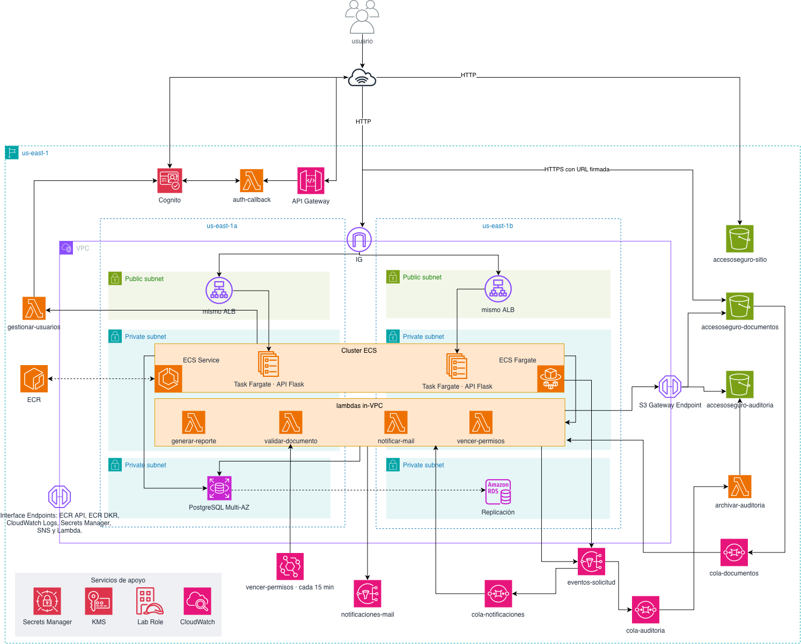

# AccesoSeguro — Infraestructura como Código

**82.08 Cloud Computing · TP3 Terraform · Grupo 3 · 2026Q2 · ITBA**

AccesoSeguro es un portal cloud para **autorizar y registrar el acceso a plantas y depósitos**.
Reemplaza las planillas en papel de cada portería: los transportistas solicitan autorización
de ingreso, el responsable de la sede la aprueba o rechaza, y portería verifica el permiso por
DNI o patente y registra el ingreso y egreso real. Todo queda centralizado y auditable.

Este repositorio levanta toda la arquitectura en AWS (Learner Lab) con Terraform y GitHub Actions:
sitio estático en S3, login con Cognito, API Flask en ECS Fargate detrás de un ALB,
RDS PostgreSQL Multi-AZ, 7 Lambdas, SNS + SQS con DLQ y EventBridge. Sin EC2 y sin NAT Gateway.

---

## Integrantes

| Nombre | Legajo |
|---|---|
| Farias, Lautaro Joaquín | 60505 |
| Berhongaray, Cruz José | 64980 |
| Santulli, Stefania Zoe | 64983 |
| Ojeda, Elías | 64977 |

---

## Índice

1. [Arquitectura](#1-arquitectura)
2. [Prerrequisitos](#2-prerrequisitos)
3. [Despliegue paso a paso](#3-despliegue-paso-a-paso)
4. [Probar la aplicación](#4-probar-la-aplicación)
5. [Destruir al terminar](#5-destruir-al-terminar)
6. [Pipeline de GitHub Actions](#6-pipeline-de-github-actions)
7. [Terraform: state remoto, módulos, funciones y meta-argumentos](#7-terraform-state-remoto-módulos-funciones-y-meta-argumentos)
8. [Estructura del repositorio](#8-estructura-del-repositorio)
9. [Decisiones por las restricciones del Learner Lab](#9-decisiones-por-las-restricciones-del-learner-lab)
10. [La aplicación en detalle](#10-la-aplicación-en-detalle)
11. [Desarrollo local y pruebas](#11-desarrollo-local-y-pruebas)

---

## 1. Arquitectura

### Diagrama de arquitectura

El diagrama muestra la arquitectura desplegada por este repositorio: la VPC en `us-east-1a` y
`us-east-1b` con tres capas de subredes (pública, aplicación y datos), los servicios gestionados
fuera de la VPC y el recorrido de un pedido de acceso de punta a punta.





### Flujo principal

1. El usuario entra al sitio (S3) e inicia sesión en la Hosted UI de Cognito. Cognito vuelve a
   API Gateway `/callback`, la Lambda `auth-callback` canjea el código y redirige al sitio con los tokens.
2. El **transportista** crea una solicitud. La API (ECS Fargate, detrás del ALB) la guarda en RDS.
   Si adjunta un PDF, lo sube directo a S3 con una URL firmada; S3 avisa a `cola-documentos` y la
   Lambda `validar-documento` registra el resultado en RDS.
3. La API publica cada evento en SNS `eventos-solicitud` (patrón outbox). Desde ahí,
   `cola-auditoria` → `archivar-auditoria` guarda el JSON en el bucket de auditoría, y
   `cola-notificaciones` → `notificar-mail` avisa por mail a quien corresponde.
4. El **responsable de sede** aprueba o rechaza. **Portería** verifica por DNI o patente y registra
   ingreso y egreso. El responsable puede exportar un reporte CSV de su sede (`generar-reporte`).
5. **EventBridge** ejecuta `vencer-permisos` cada 15 minutos: vence los permisos aprobados que no
   se usaron y reintenta los avisos pendientes.

### Capas, servicios y archivos

| Capa | Servicio | Archivo | Recursos principales |
|---|---|---|---|
| Front | S3 sitio estático | `frontend.tf` | `module.sitio`, website, policy pública de lectura, `aws_s3_object` |
| Identidad | Cognito + API Gateway /callback + Lambda | `identity.tf` | User Pool, 3 roles (transportistas, porteros y responsables_sede), dominio, app client, HTTP API |
| Entrada | Internet Gateway + ALB | `modules/network`, `alb.tf` | IGW, `aws_lb`, target group tipo `ip`, listener 80 |
| Cómputo | ECS Fargate, ECR, 7 Lambdas | `ecs.tf`, `lambdas.tf` | cluster, task definition, service, autoscaling, `module.lambdas` |
| Datos | RDS Multi-AZ, 2 buckets privados | `database.tf`, `storage.tf` | `aws_db_instance.main`, `module.buckets` |
| Eventos | SNS, SQS + DLQ, EventBridge, SNS por mail | `messaging.tf`, `lambdas.tf` | tópicos, `module.sqs`, suscripciones, DLQs de entrega, schedule cada 15 minutos (configurable) |
| Seguridad | VPC, SG, NACL, Secrets Manager, KMS, LabRole; CloudTrail propio opcional | `network.tf`, `security.tf` | SG encadenados, NACL de datos, clave KMS, secretos; `enable_cloudtrail = false` por defecto |
| Operación | CloudWatch, Auto Scaling | `monitoring.tf`, `ecs.tf` | alarmas (5xx, tasks sanas, DLQ, errores Lambda, RDS, avisos atrasados) |

### Red

La red se despliega en **us-east-1a y us-east-1b**, con una subred por capa en cada zona.

| Subred | CIDR | Contiene | Ruta a internet |
|---|---|---|---|
| publica-a / publica-b | 10.0.1.0/24 y 10.0.2.0/24 | ALB | Sí (IGW) |
| app-a / app-b | 10.0.11.0/24 y 10.0.12.0/24 | Tasks de ECS, Lambdas en la VPC, endpoints | No |
| datos-a / datos-b | 10.0.21.0/24 y 10.0.22.0/24 | RDS primaria y standby | No |

Security Groups encadenados: `alb` (80 desde internet) → `ecs` (5000 solo desde `alb`) →
`rds` (5432 solo desde `ecs` y `lambda`); `endpoints` (443 desde `ecs` y `lambda`).

---

## 2. Prerrequisitos

El despliegue se ejecuta en **GitHub Actions**; para usarlo solo hacen falta las credenciales del
Learner Lab cargadas como secrets (sección 3). Para trabajar en una máquina local:

| Herramienta | Versión / nota |
|---|---|
| Terraform | ≥ 1.10 (`terraform -version`) |
| AWS CLI | v2; se usa para crear y borrar los buckets |
| Python | 3.12 |
| Docker | Funcionando, para construir la imagen de la API |
| Node.js | 22, solo para las pruebas del frontend |

Credenciales del Learner Lab: **AWS Details → AWS CLI**, pegarlas en `~/.aws/credentials`
(son temporales; renovarlas cuando venzan) y comprobar:

```bash
aws sts get-caller-identity   # tiene que mostrar el account id del lab
```

---

## 3. Despliegue paso a paso

### 3.1 Configurar los secrets

En el repositorio que ejecuta el workflow: **Settings → Secrets and variables → Actions**.

| Secret | Obligatorio | Valor |
|---|---|---|
| `AWS_ACCESS_KEY_ID` | Sí | Del Learner Lab |
| `AWS_SECRET_ACCESS_KEY` | Sí | Del Learner Lab |
| `AWS_SESSION_TOKEN` | Sí | Del Learner Lab; renovar cuando venza |
| `TF_STATE_BUCKET` | No | Bucket del state de un despliegue existente. Si no está, se usa `accesoseguro-tfstate-<account_id>` |

### 3.2 Ejecutar el despliegue

1. El workflow manual tiene que estar en `main` para que GitHub muestre el botón
   ([requisito de GitHub](https://docs.github.com/en/actions/how-tos/manage-workflow-runs/manually-run-a-workflow)).
   Al ejecutarlo se elige la rama a desplegar.
2. **Actions → desplegar-aplicacion → Run workflow**, seleccionando la rama.
3. Esperar el resultado (la primera vez tarda bastante por RDS Multi-AZ) y abrir la URL publicada
   en el resumen del run.

No hace falta crear tablas ni subir la imagen a mano. El workflow:

1. Corre las pruebas y construye la Layer de las Lambdas y la imagen Linux de la API.
2. Crea o recupera el bucket del state e inicializa y valida Terraform.
3. Si ya hay una instalación, pausa la API, el Auto Scaling y los consumidores que usan RDS
   (auditoría sigue activa).
4. `plan` y `apply` con `deployment_ready=false` y publica la imagen en ECR.
5. Ejecuta `python manage_db.py upgrade` como
   [tarea puntual de ECS](https://docs.aws.amazon.com/AmazonECS/latest/developerguide/standalone-tasks.html),
   con la misma imagen, red y permisos que la API: crea tablas, relaciones y tres sedes iniciales.
6. `plan` y `apply` con `deployment_ready=true`; activa ECS y comprueba revisión, cantidad de
   tareas, `/health`, el sitio y una invocación real de reportes.

La imagen usa el SHA completo del commit como tag inmutable: repetir el commit reutiliza la imagen.
Si falla la imagen o la inicialización de la base, el script no avanza a la activación.

Equivalente desde un checkout limpio, con Python 3.12, Terraform, AWS CLI y Docker:

```bash
make deploy
```

`make plan` y `make apply` por separado no reemplazan el proceso completo. El despliegue usa
`accesoseguro/dev` en `us-east-1`; el resto de los valores salen de `variables.tf` o de un
`terraform/infra/terraform.tfvars` local (ignorado por Git, no se traslada a Actions).

### 3.3 Si algo falla

Revisar el paso que falló y los logs de la tarea o Lambda en CloudWatch, corregir y volver a
ejecutar el workflow **con el mismo bucket de state**; no cambiarlo para sortear un error.
Las tablas se preparan de forma aditiva, en una transacción y con bloqueo de PostgreSQL, sin
duplicar sedes ni borrar solicitudes. `/health` responde 503 mientras RDS o su esquema no estén
disponibles.

---

## 4. Probar la aplicación

Ver las URLs del despliegue en el resumen del workflow o con:

```bash
make outputs    # sitio_url, api_url, login_url...
```

Si se desplegó desde Actions y se quiere usar `make outputs` o `make grupo` en otra copia local,
primero apuntar al mismo state:

```bash
cp terraform/infra/backend.hcl.example terraform/infra/backend.hcl
# Editar bucket con el nombre del state de ese despliegue; conservar key, región y lock.
make init
```

1. Abrir `sitio_url` → **Ingresar** → registrarse en la Hosted UI de Cognito (llega un código al mail).
2. Un usuario sin grupo puede activar su cuenta como **transportista**. No puede elegirse personal de planta.
3. El operador del Lab asigna los roles internos y una sede existente:
   ```bash
   make grupo EMAIL=portero@example.com GRUPO=porteros SEDE=1
   make grupo EMAIL=responsable@example.com GRUPO=responsables_sede SEDE=2
   ```
   El script reemplaza el rol anterior del usuario por uno único; después el usuario vuelve a
   iniciar sesión. Ver [Cognito y roles](docs/cognito-y-roles.md).
4. Recorrer el flujo: el transportista crea una solicitud (con PDF opcional), el responsable de
   la sede la aprueba y portería la verifica por DNI o patente y registra el ingreso y el egreso.
5. Comprobar los resultados: los movimientos quedan en RDS y en el reporte CSV; el bucket de
   auditoría recibe los eventos de creación, aprobación, rechazo y vencimiento; los avisos llegan
   por mail a quienes confirmaron la suscripción de SNS.

---

## 5. Destruir al terminar

Conviene bajar la infraestructura cuando no se usa (después de la corrección o entre sesiones),
porque RDS Multi-AZ, el ALB, los VPC Endpoints y las tasks de Fargate consumen crédito del Lab.

1. **Actions → destruir-infraestructura → Run workflow**.
2. En el campo de confirmación escribir `destruir` (cualquier otro texto cancela sin borrar nada).

El workflow usa el mismo state remoto que el despliegue, empaqueta la Layer (la exige una
precondición de `lambdas.tf`) y ejecuta `terraform destroy`. Si no encuentra state, termina sin
cambios. **Borra todo**, incluidos los datos de RDS, los buckets y los usuarios de Cognito.
Si falla por una dependencia que AWS tarda en liberar (por ejemplo, las interfaces de red de
las Lambdas en la VPC), volver a ejecutarlo.

Equivalente local, con las credenciales del Lab: `make destroy`.

El bucket del state **no** se destruye (`prevent_destroy` en `bootstrap/`): un nuevo despliegue
lo reutiliza.

---

## 6. Pipeline de GitHub Actions

| Workflow | Cuándo | Qué ejecuta |
|---|---|---|
| `terraform.yml` | PR a `main` o manual | `fmt`, `init`, `validate`; `plan` con credenciales y backend existente |
| `tests.yml` | PR, manual y antes de desplegar | Python, PostgreSQL 16, frontend y Layer Linux |
| `deploy.yml` | Manual: **desplegar-aplicacion** | Pruebas y despliegue completo: `init`, `validate`, `plan`, `apply`, imagen, esquema y comprobaciones |
| `destroy.yml` | Manual: **destruir-infraestructura**, con confirmación `destruir` | `init` y `destroy` de toda la infraestructura; conserva el bucket del state |

- Para un primer despliegue se ejecuta **desplegar-aplicacion**: el bucket del state se crea solo.
  El `plan` de los PR necesita ese backend ya creado.
- En un PR desde un fork, GitHub no entrega los secrets: se ejecutan las pruebas y la validación,
  y el workflow informa que el plan no se ejecutó. El repositorio receptor debe tener sus propias
  credenciales configuradas para desplegar.
- Los workflows de Terraform, despliegue y destroy comparten un grupo de concurrencia: nunca
  corren a la vez sobre el mismo state.

---

## 7. Terraform: state remoto, módulos, funciones y meta-argumentos

### 7.1 Por qué hay dos proyectos de Terraform

Terraform guarda en el **state** qué recursos creó. Si queda en la máquina de una sola persona,
el resto del equipo y el pipeline no pueden trabajar, así que va a un **backend remoto en S3**.
Ese bucket tiene que existir antes que el Terraform principal, por eso hay dos proyectos:

| Proyecto | Qué crea | Dónde guarda su propio state |
|---|---|---|
| `bootstrap/` | El bucket del state (versionado, cifrado, privado, solo HTTPS, `prevent_destroy`) y genera `infra/backend.hcl` | Primero local; el despliegue lo migra al mismo bucket |
| `infra/` | Toda la arquitectura de AccesoSeguro | En el bucket creado por `bootstrap/` |

- El nombre del bucket es una variable y por defecto es `accesoseguro-tfstate-<account_id>`,
  único a nivel global.
- Los states quedan en `accesoseguro/dev/bootstrap.tfstate` y `accesoseguro/dev/infra.tfstate`,
  cifrados. `terraform/bootstrap/backend_override.tf` activa el backend y se genera sin versionarse.
- **Lock:** con Terraform ≥ 1.10 el [backend S3](https://developer.hashicorp.com/terraform/language/backend/s3)
  bloquea el state con un archivo `.tflock` (`use_lockfile = true`): si dos personas hacen
  `apply` a la vez, la segunda espera. La tabla DynamoDB del método clásico queda como opción
  (`create_dynamodb_lock_table`).

### 7.2 Módulos

| Módulo | Tipo | Para qué | Cómo se usa |
|---|---|---|---|
| `modules/network` | **Propio** | VPC en 3 capas x 2 AZ, IGW, tablas de ruteo y NACL | Una vez, en `network.tf` |
| `modules/lambda-function` | **Propio** | Empaquetar y crear una Lambda con su log group | Una llamada con `for_each` crea las 7 |
| `modules/sqs-with-dlq` | **Propio** | Cola + DLQ + alarma | Una llamada con `for_each` crea las 3 colas |
| `modules/s3-bucket` | **Propio** | Bucket con cifrado, versionado, políticas, lifecycle, CORS y website, compatible con el Learner Lab | `for_each` (documentos y auditoría), una vez para el sitio y con `count` para CloudTrail |
| `terraform-aws-modules/ecr/aws` `~> 2.0` | **Externo** (Terraform Registry) | Repositorio ECR con tags inmutables, escaneo, cifrado KMS y lifecycle policy | Una vez, en `ecs.tf` |

Cada módulo propio tiene `main.tf`, `variables.tf`, `outputs.tf`, `versions.tf` y su `README.md`.

### 7.3 Funciones

| Función | Dónde | Para qué |
|---|---|---|
| `cidrsubnet()` | `modules/network/main.tf` | Calcular el CIDR de cada subred a partir de la VPC |
| `cidrhost()` + `can()` | `modules/network/variables.tf` | Validar que `vpc_cidr` sea un CIDR válido |
| `merge()` | network, `locals.tf` | Unir los mapas de subredes por capa; unir nombres de buckets |
| `substr()` | network, `alb.tf` | Letra de la AZ (`us-east-1a` → `a`); recortar nombres a 32 caracteres |
| `format()` | `locals.tf`, `data.tf`, `bootstrap/main.tf` | Armar nombres de bucket, key del state, dominio de Cognito y URLs (login y JWKS) |
| `coalesce()` | `bootstrap/main.tf` | Usar el nombre de bucket pasado o, si está vacío, uno generado |
| `templatefile()` | `bootstrap/main.tf`, `frontend.tf` | Generar `backend.hcl` y el `config.js` del sitio con valores reales |
| `jsonencode()` | KMS, bucket policies, SQS, ECS, ECR | Escribir políticas y definiciones JSON en HCL |
| `fileset()` + `setsubtract()` | `locals.tf` | Listar los archivos del sitio para subirlos (sin la plantilla) |
| `filemd5()` | `frontend.tf` | Volver a subir un archivo solo si cambió |
| `lookup()`, `split()`, `element()`, `length()`, `lower()` | `frontend.tf` | Elegir el Content-Type según la extensión |
| `urlencode()`, `join()` | `locals.tf` | Armar la URL de login de la Hosted UI |
| `keys()`, `sort()` | `ecs.tf` | Pasar el mapa de variables de entorno al formato de ECS |
| `toset()`, `concat()` | `locals.tf`, `network.tf`, `monitoring.tf`, `modules/s3-bucket` | Sets para `for_each` (colas suscriptas, endpoints, alarmas); unir statements de la bucket policy |
| `tostring()` | `locals.tf` | Las variables de entorno tienen que ser strings |
| `title()`, `replace()` | `messaging.tf`, `network.tf` | Armar el `Sid` de la policy y el nombre de cada endpoint |
| `max()` | `ecs.tf`, `locals.tf` | El máximo del Auto Scaling nunca queda por debajo del mínimo; umbral mínimo de la alarma de avisos atrasados |
| `formatdate()`, `timestamp()` | `database.tf` | Nombre del snapshot final en prod |
| `one()` | `bootstrap/outputs.tf` | Output de un recurso creado con `count` (o `null`) |
| `contains()`, `regex()` | `variables.tf` | Validaciones de entrada |

### 7.4 Meta-argumentos

| Meta-argumento | Dónde | Por qué |
|---|---|---|
| `for_each` | Subredes, rutas, SG y sus reglas, endpoints, grupos de Cognito, `module.lambdas`, `module.sqs`, `module.buckets`, event source mappings, suscripciones SNS, alarmas | Crear N recursos parecidos a partir de un mapa, con claves estables (`publica-a`, `cola-auditoria`) |
| `count` | IGW (si hay capa pública), CloudTrail y su bucket (`enable_cloudtrail`, también sobre un `module`), website / lifecycle / CORS opcionales en `s3-bucket`, suscripción de alarmas por mail, tabla DynamoDB de locks, `local_file` del backend | Recursos opcionales: 0 o 1 según una variable |
| `depends_on` | Policy del bucket después del public access block; notificación S3 después de la policy de la cola; suscripción SNS después de la policy; servicio ECS después del listener y de los endpoints; CloudTrail después de la policy del bucket; log group antes de la Lambda | Dependencias que AWS exige pero que Terraform no puede deducir de las referencias |
| `lifecycle { prevent_destroy }` | Bucket del state (`bootstrap/`) | Que un `destroy` nunca borre el state |
| `lifecycle { create_before_destroy }` | Security Groups, parameter group de RDS | Reemplazar sin cortar: AWS no deja borrar un SG en uso |
| `lifecycle { ignore_changes }` | `desired_count` del servicio ECS; `schema` del User Pool; snapshot final de RDS | No pelear con el Auto Scaling; Cognito no permite modificar el schema (recrearía el pool y se perderían los usuarios) |

También se usan **bloques `dynamic`** (`vpc_config` de las Lambdas, reglas de la NACL,
reglas de lifecycle y CORS de los buckets),
**validaciones** en las variables y bloques **`moved`** que conservan las colas, políticas y
alarmas renombradas en la versión 4 sin recrearlas
([refactorización en Terraform](https://developer.hashicorp.com/terraform/language/modules/develop/refactoring));
no eliminarlos por limpieza.

### 7.5 Variables y outputs principales

| Entrada / salida | Uso |
|---|---|
| `api_min_tasks`, `api_max_tasks`, `api_cpu`, `api_memory` | Capacidad de ECS; por defecto 2–4 tareas, 256 CPU y 512 MB por tarea |
| `db_instance_class`, `db_multi_az`, `db_allocated_storage` | RDS: `db.t3.micro`, Multi-AZ y 20 GB por defecto |
| `permiso_vigencia_segundos`, `vencer_permisos_intervalo_minutos` | Vigencia de 24 horas; revisión y reintentos cada 15 minutos |
| `max_pdf_size_mb`, `presigned_url_ttl_seconds` | PDF máximo de 10 MB; enlaces firmados de 300 segundos |
| `alarm_email`, `enable_cloudtrail` | Correo de alarmas y trail propio, opcionales |
| `api_image_tag`, `deployment_ready` | Los administra el script: SHA del commit y habilitación tras preparar la base |
| `sitio_url`, `api_url`, `login_url` | Direcciones para probar la aplicación |
| `cognito_user_pool_id`, `lambda_functions` | Identificadores para los scripts de usuarios y notificaciones |
| `deployment`, `ecr_repository_url`, `ecs_*` | Datos que usa el despliegue para publicar la imagen e inicializar RDS |

Todas las entradas están en [variables.tf](terraform/infra/variables.tf), con ejemplos en
[terraform.tfvars.example](terraform/infra/terraform.tfvars.example); las salidas, en
[outputs.tf](terraform/infra/outputs.tf). No guardar credenciales en esos archivos.

---

## 8. Estructura del repositorio

```
.
├── .github/workflows/
│   ├── terraform.yml                 # fmt, init, validate y plan en cada PR
│   ├── tests.yml                     # pruebas de API, PostgreSQL, frontend y Layer
│   ├── deploy.yml                    # despliegue completo manual, incluidas imagen y RDS
│   └── destroy.yml                   # destroy manual de toda la infraestructura (con confirmación)
├── terraform/
│   ├── bootstrap/                    # 1er Terraform: bucket del state (+ genera infra/backend.hcl)
│   ├── infra/                        # 2do Terraform: la arquitectura, un archivo por capa
│   │   ├── versions.tf  variables.tf  locals.tf  data.tf  outputs.tf
│   │   ├── network.tf  security.tf  frontend.tf  storage.tf  identity.tf
│   │   ├── alb.tf  ecs.tf  database.tf  lambdas.tf  messaging.tf  monitoring.tf
│   │   └── backend.hcl.example  terraform.tfvars.example
│   └── modules/                      # módulos propios
│       ├── network/                  # VPC, subredes, IGW, rutas y NACL
│       ├── lambda-function/          # Lambda + zip + log group
│       ├── sqs-with-dlq/             # cola + DLQ + alarma
│       └── s3-bucket/                # bucket compatible con el Learner Lab
├── lambdas/<nombre>/handler.py       # código de las 7 Lambdas (+ layers/ con sus dependencias)
├── backend/                          # API Flask + Dockerfile (imagen de ECS)
├── frontend/                         # sitio estático (HTML/CSS/JS) + config.js.tftpl
├── scripts/                          # deploy.py, Layer, asignación de roles y notificaciones
├── tests/                            # pruebas de API, roles, notificaciones, buckets y despliegue
├── docs/                             # Cognito/roles y operación de notificaciones
├── Makefile                          # atajos: deploy / validate / test / grupo / destroy (make help)
└── README.md
```

Convenciones: todos los recursos se llaman `<proyecto>-<ambiente>-<componente>`
(ej. `accesoseguro-dev-cola-auditoria`); los nombres locales de Terraform van en `snake_case`;
los recursos únicos de un módulo se llaman `this`.

---

## 9. Decisiones por las restricciones del Learner Lab

Estas decisiones responden al Lab y a lo acordado para esta entrega; los permisos efectivos de
la cuenta se verifican al ejecutar el workflow.

| Restricción | Cómo se resolvió |
|---|---|
| Lectura de Object Lock restringida en el Lab | El bucket se crea con AWS CLI desde `terraform_data` + `local-exec` (módulo `s3-bucket`); cifrado, versionado, políticas, lifecycle y website siguen en Terraform. Lo mismo para el bucket del state |
| No se pueden crear roles IAM | ECS y Lambdas usan `LabRole` (`data.aws_iam_role.lab_role`). Sí se escriben políticas sobre los recursos (buckets, colas, KMS) |
| Se acordó mantener sitio y API por HTTP | Cognito vuelve a API Gateway `/callback` (HTTPS) y la Lambda redirige al sitio con los tokens en el `#`. Es el workaround de clase; el tramo HTTP no cifra el tráfico y no corresponde a una configuración de producción |
| Las tasks no tienen salida a internet | VPC Endpoints. Las llaves públicas de Cognito (JWKS) las lee Terraform (`data.http`) y se pasan al contenedor como variable de entorno |
| SES: el LabRole no tiene `ses:VerifyEmailIdentity`, y en sandbox SES solo manda a direcciones verificadas | Los avisos salen por **SNS por mail**: tópico `notificaciones-mail` + una suscripción por persona administrada por `gestionar-usuarios`. Cada una confirma con el link que manda AWS. La Lambda publica con el atributo `destinatario_id` y la *filter policy* de cada suscripción hace que cada uno reciba solo lo suyo (cada responsable recibe además las solicitudes nuevas de su sede). En producción se volvería a SES con el dominio verificado |
| CloudTrail | El trail propio queda detrás de `enable_cloudtrail`; el [historial de eventos de administración](https://docs.aws.amazon.com/awscloudtrail/latest/userguide/view-cloudtrail-events.html) de los últimos 90 días no lo requiere |
| Se destruye y recrea seguido | `force_destroy` en buckets, `recovery_window_in_days = 0` en secretos, `skip_final_snapshot` fuera de prod |

---

## 10. La aplicación en detalle

- **`backend/`** — API Flask en ECS con PostgreSQL y credenciales de Secrets Manager. Valida el
  Access Token y consulta el perfil y los grupos vigentes mediante `gestionar-usuarios`. Autoriza
  tres roles: **transportistas** (solicitudes propias), **porteros** (ingresos/egresos de su sede)
  y **responsables_sede** (aprobaciones, reportes y auditoría de su sede). Los roles internos solo
  los asigna el operador AWS.
- **`frontend/`** — HTML/CSS/JS sin build. Conserva el callback HTTPS de clase, guarda Access Token
  e ID Token en sessionStorage y usa solo el primero para la API.
- **Lambdas** — las cuatro que acceden a RDS (`validar-documento`, `vencer-permisos`,
  `notificar-mail` y `generar-reporte`; `usa_rds = true` en `locals.tf`) comparten una
  [Layer](https://docs.aws.amazon.com/lambda/latest/dg/python-layers.html) con el driver
  PostgreSQL, SQLAlchemy, el código común y los certificados de RDS, para Python 3.12 y Linux x86_64.
  Antes de un `make plan` local hay que ejecutar `make layer`.

### Documentos

1. La API comprueba que la solicitud es del transportista, sigue pendiente y el tamaño informado
   es válido. Registra el documento como **pendiente** y entrega una URL temporal para cargarlo.
2. El navegador sube el PDF directo a S3, y S3 avisa por `cola-documentos`.
3. `validar-documento` lee **la versión exacta** del objeto y comprueba tipo declarado, tamaño
   (mayor que cero y hasta el máximo configurado) y cabecera `%PDF-`.
4. Guarda **válido** o **rechazado**, el motivo y la versión en `documento_validacion`.
5. Si la solicitud tiene un documento, el responsable no puede aprobarla hasta que sea válido.
   El enlace abre la versión validada aunque después se vuelva a escribir la misma clave.

El adjunto es opcional, y la validación es técnica y básica: no analiza malware, autenticidad ni
contenido legal. El transportista puede reemplazar un archivo pendiente o rechazado desde
**Mis solicitudes**. Los eventos repetidos o atrasados no pisan un resultado más reciente (se
compara el [`sequencer`](https://docs.aws.amazon.com/AmazonS3/latest/userguide/notification-content-structure.html)),
y ante fallas de S3 o RDS el mensaje se reintenta con
[respuestas parciales de Lambda/SQS](https://docs.aws.amazon.com/lambda/latest/dg/services-sqs-errorhandling.html).

### Reportes

1. El responsable pide un reporte; la API toma la sede de su perfil autorizado, no del navegador.
2. Invoca `generar-reporte`, que consulta las solicitudes e ingresos/egresos reales de esa sede.
   El filtro es por fecha de creación, el día final se incluye completo y las fechas son UTC.
3. La Lambda guarda el CSV en `reportes/` del bucket privado de auditoría (cifrado y con
   eliminación al día).
4. Devuelve una URL firmada temporal; el navegador descarga sin enviar el token de Cognito a S3.

Sin registros, el CSV tiene solo encabezados. Se rechazan rangos inválidos y reportes de más de
10.000 filas. Los inicios de fórmula se escapan como mitigación de
[CSV injection](https://owasp.org/www-community/attacks/CSV_Injection).

### Notificaciones y vencimientos

`vencer-permisos` corre cada `vencer_permisos_intervalo_minutos` (15 por defecto): vence en RDS
los permisos aprobados y no usados después de `permiso_vigencia_segundos` y reintenta los avisos
pendientes del outbox. `notificar-mail` registra en RDS lo que publicó para no duplicar avisos.
Las suscripciones de mail se activan desde la aplicación o con `scripts/notificaciones.py`, y el
script de roles actualiza los filtros solo. El circuito completo, la confirmación de SNS, los
reintentos y la recuperación de fallos están en [notificaciones.md](docs/notificaciones.md).

---

## 11. Desarrollo local y pruebas

Probar la aplicación sin AWS:

```bash
cd backend && pip3 install -r requirements.txt && LOCAL_DEMO=true python3 app.py   # terminal 1
cd frontend && python3 -m http.server 8000                                         # terminal 2
# abrir http://localhost:8000/login.html
```

Antes de subir cambios, en un entorno Python con `pip install -r backend/requirements.txt`:

```bash
make fmt        # formatea el código Terraform
make validate   # fmt -check + init sin backend + validate de los dos proyectos (no requiere AWS)
make test       # pruebas de Python y frontend
```

Las pruebas de PostgreSQL necesitan `TEST_POSTGRES_URL` apuntando a una base de pruebas;
Actions la provee y, sin ella, esas pruebas se omiten. No subir credenciales, state ni planes al
repositorio.
